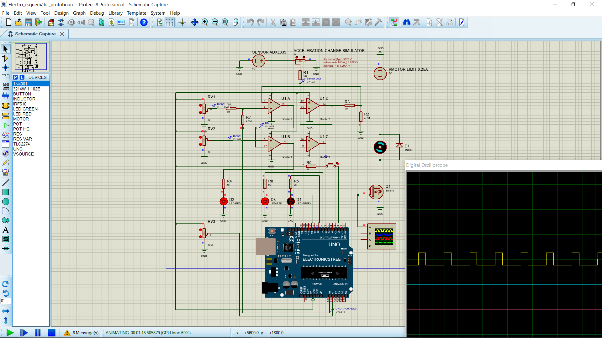
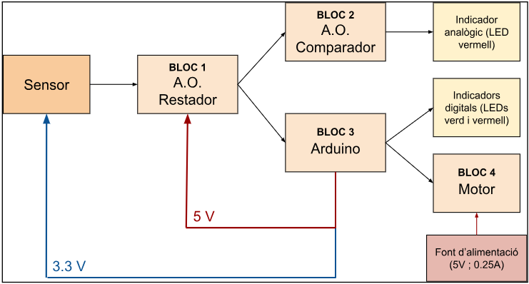
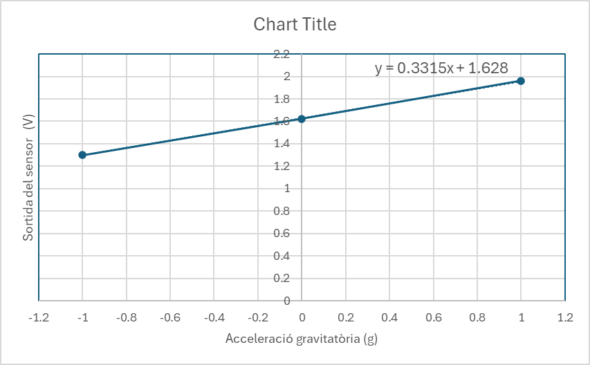
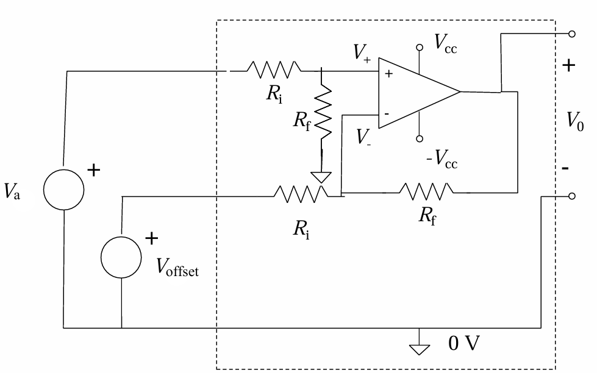

# Inclination Detection System

Arduino-based prototype that measures and corrects lateral inclination with an ADXL335 accelerometer, analog signal conditioning, a redundant analog alert and a DC motor controlled through PWM.

The project was developed for the Electronics course of the Aerospace Systems Engineering degree at EETAC (UPC), as a first approach to a drone stabilization system.



## Overview

The ADXL335 measures the acceleration of gravity along one axis, which changes with the lateral inclination of the board. Its analog output is filtered, amplified and shifted by an operational amplifier so that it uses the whole input range of the Arduino ADC. The Arduino compares the measurement with a threshold of 0.9 g: above it a green LED indicates normal operation, and below it a red LED turns on and a DC motor can be driven to correct the inclination.

A second, purely analog comparator turns the red LED on at the same threshold, so the alert keeps working even if the microcontroller fails.



## Specifications

| Characteristic | Requirement | Result |
| --- | --- | --- |
| Measurement range | ±1.2 g | ±1.2 g |
| Resolution | 5 mg | 3.3 mg |
| Accuracy | ±0.03 g | ±0.0247 g |
| Bandwidth | 10 Hz | 10 Hz |
| Activation threshold | 0.9 g | 0.9 g |

## Features

- Acceleration measurement with an ADXL335 accelerometer powered at 3.3 V
- Low-pass filter that sets a 10 Hz bandwidth
- Differential amplifier (TLC2274) that adapts the sensor signal to the 0–5 V range of the ADC
- Redundant analog comparator that drives the red LED without the microcontroller
- Green and red status LEDs
- DC motor switched by an IRF510 MOSFET with a 1N4001 flyback diode
- Motor on/off with a debounced push button and speed control with a potentiometer (PWM)
- Two-point calibration of the complete measurement chain
- Serial output for monitoring

## Hardware

- Arduino UNO
- ADXL335 three-axis accelerometer
- TLC2274 operational amplifier (differential amplifier and comparator)
- Green and red LEDs
- Push button and potentiometers
- MOV36 DC motor, IRF510 MOSFET and 1N4001 diode

## System design

### Sensor

The sensor was characterised at −1 g, 0 g and +1 g. Its response is linear, with a measured sensitivity of 331.5 mV/g and an offset of 1.628 V:

```
Vsensor = 0.3315 · a + 1.628        (V, with a in g)
```



### Signal conditioning

A resolution of 5 mg corresponds to 1.5 mV at the sensor output, while the 10-bit ADC only resolves about 5 mV. A differential amplifier increases the sensitivity and centres the signal, so that ±1.2 g fits inside the 0–5 V input range of the ADC without saturating, also in the worst case of resistor tolerances.



### Redundant alert

An operational amplifier used as a comparator receives the conditioned signal and a reference of 3.77 V, the voltage that corresponds to 0.9 g. When the acceleration falls below the threshold, its output turns the red LED on independently of the Arduino.

### Motor stage

The motor is powered from a separate 5 V supply limited to 0.25 A. The Arduino PWM signal switches the IRF510 MOSFET, and the flyback diode protects it from the voltage peaks of the inductive load.

## System operation

- **Above 0.9 g:** the green LED is on (normal operation).
- **Below 0.9 g:** the red LED is on.
- **Motor:** the push button toggles the motor and the potentiometer on A1 sets its speed through PWM.
- **Serial monitoring:** the measurement is sent at 9600 baud.

## Pin configuration

| Arduino pin | Function |
| --- | --- |
| A0 | Conditioned accelerometer signal |
| A1 | Potentiometer input |
| D2 | Push button |
| D7 | Red LED |
| D8 | Green LED |
| D10 | DC motor PWM control |

## Arduino code

The Arduino sketch is available in:

```
Arduino/InclinationDetectionSystem/InclinationDetectionSystem.ino
```

## Running the project

1. Open the sketch in the Arduino IDE.
2. Select the Arduino UNO board and the serial port.
3. Build the circuit following the Proteus schematic in `Proteus/InclinationDetectionSystem.pdsprj`.
4. Power the accelerometer from the 3.3 V output of the Arduino (never above 3.6 V) and connect all the grounds together.
5. Upload the sketch and open the Serial Monitor at 9600 baud.
6. Use the push button and the potentiometer to control the motor.

The circuit can also be simulated by opening the Proteus project with Proteus 8 Professional.

## Repository structure

| Path | Content |
| --- | --- |
| `Arduino/` | Arduino sketch |
| `Proteus/` | Proteus 8 project with the complete schematic |
| `images/` | Diagrams, schematics and calibration plots |
| `docs/Memoria_Tecnica.pdf` | Technical report (in Catalan) |
| `docs/Presentacio.pdf` | Project presentation (in Catalan) |

## Technologies

- Arduino UNO
- Embedded C/C++ (Arduino sketch)
- Analog signal conditioning with operational amplifiers
- Accelerometer interfacing
- PWM motor control
- Proteus circuit design and simulation

## Contributors

- Ferran Alegre Baltasar - [@ferran-alegre](https://github.com/ferran-alegre)
- Júlia Martín
- Ángela Parga
